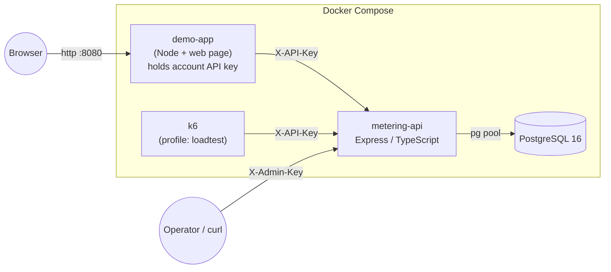
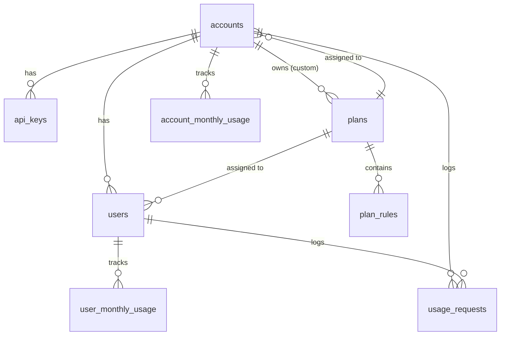

# Usage Metering & Quota Service — System Design

> Status: **Design, pre-implementation** · Stack: **TypeScript** (Node 22) + **Express 5** + **PostgreSQL 16** · One service, one database.
> This document is the source of truth for implementation. Every decision here should be defensible in the review.

---

## 0. TL;DR

- **One HTTP service** (Express 5 + `pg`, raw SQL, TypeScript) in front of **one PostgreSQL** database.
- The hot path is `POST /v1/consume`. It runs as **one short database transaction** that:
  1. checks the idempotency ledger,
  2. rejects per-request violations **without taking any lock**,
  3. locks the **account** monthly counter row, then the **user** monthly counter row (fixed order → no deadlocks),
  4. evaluates the rules with a **pure TypeScript function**,
  5. either increments both counters or neither, and appends one row to the **request ledger**,
  6. commits.
- **Correctness is enforced by the database**, not by the app: row locks serialize competing requests on the same counter, a `UNIQUE (account_id, request_id)` makes retries safe, `CHECK` constraints keep counters sane.
- **Invariant we test and check after every load test:**
  `counter.used == SUM(units) of accepted ledger rows` for every (account, month) and (user, month).
- Plans are **data**, read inside the consume transaction → changes apply to the next request, no redeploy, no cache to invalidate.
- Every decision stores a **snapshot of the limits it was evaluated against**, so history survives plan edits.

---

## 1. Context & Classification

| Item             | Answer                                                                                                                                        |
| ---------------- | --------------------------------------------------------------------------------------------------------------------------------------------- |
| Component type   | Synchronous **HTTP API** (command + queries), called server-to-server by the client application's backend.                                    |
| Callers          | (a) an **operator** (us) creating accounts with an admin key; (b) **account backends** using their API key. End users never call us directly. |
| Latency budget   | Consume is on the caller's critical path ("before processing a document"). Target **p99 < 50 ms** under normal load on a laptop.              |
| Consistency need | **Strong.** Over-granting quota is the main correctness bug. We prefer a slightly slower correct answer over a fast wrong one.                |
| Retry model      | Callers _will_ retry on timeouts → consume must be idempotent by `requestId`.                                                                 |
| Scale assumption | Single node. Many accounts, but realistic contention is "many users of one account" hitting the same account counter.                         |

---

## 2. Architecture



Why the demo app has its own backend: the brief says the _application's backend_ calls us. Putting the API key in browser JavaScript would teach the wrong pattern. The demo server holds the key and exposes a tiny UI.

### 2.1 Layering inside the service

```
http (Express routers, auth middleware, zod validation, error middleware)
  └─> services (use-cases: consume, managePlans, manageUsers, queryUsage)
        ├─> domain/rules   ← pure functions, no I/O, 100% unit-testable
        └─> repositories   ← SQL only, one file per aggregate
              └─> db (pool, tx helper, migrations, seed)
```

Rules know nothing about HTTP or SQL. Repositories know nothing about rules. The consume service is the only place that orchestrates locking + evaluation + accounting.

### 2.2 Tech choices (boring by default)

| Concern            | Choice                                                                                                             | Why                                                                                                                                                                                                                                                                                                                                                            |
| ------------------ | ------------------------------------------------------------------------------------------------------------------ | -------------------------------------------------------------------------------------------------------------------------------------------------------------------------------------------------------------------------------------------------------------------------------------------------------------------------------------------------------------- |
| Language           | **TypeScript** (strict mode)                                                                                       | Types for the domain (rules, decisions, errors) catch mistakes before runtime and document the contracts between layers.                                                                                                                                                                                                                                       |
| HTTP               | **Express 5**                                                                                                      | The framework the team already knows well, so time goes into correctness instead of learning a new tool. Express 5 forwards rejected promises from async handlers to the error middleware, so no `try/catch` per route. Framework speed is not the bottleneck: consume time is dominated by the account-row lock in Postgres (§11), which the load test shows. |
| Validation / types | **zod**                                                                                                            | One schema → runtime validation + inferred TS types (`z.infer`). Used in a small `validate(schema)` middleware.                                                                                                                                                                                                                                                |
| DB access          | **`pg` + raw SQL**                                                                                                 | The brief says "TypeScript and SQL". Locking semantics must be explicit and visible; ORMs hide `FOR UPDATE` and round trips.                                                                                                                                                                                                                                   |
| Migrations         | Plain numbered `.sql` files + tiny runner with a `schema_migrations` table, run on startup under an advisory lock. | Zero magic; safe if two instances start.                                                                                                                                                                                                                                                                                                                       |
| Logs               | **pino** + **pino-http** (JSON)                                                                                    | Structured request logs as one Express middleware, fast.                                                                                                                                                                                                                                                                                                       |
| Metrics            | **prom-client** at `/metrics`                                                                                      | RED metrics + decision counters for load-test analysis.                                                                                                                                                                                                                                                                                                        |
| Tests              | **Vitest** + **supertest** against a real Postgres (compose `db-test` service)                                     | supertest calls the Express app in-process, no running server needed. Concurrency bugs only show up against a real database; mocks would prove nothing.                                                                                                                                                                                                        |
| Load test          | **k6** (container, compose profile)                                                                                | Scriptable scenarios, thresholds, JSON summary committed to repo.                                                                                                                                                                                                                                                                                              |

---

## 3. Domain Model

| Concept                    | Notes                                                                                                                                                |
| -------------------------- | ---------------------------------------------------------------------------------------------------------------------------------------------------- |
| **Account**                | Tenant. Has exactly one _account-scope_ plan. Owns API keys, users, custom plans.                                                                    |
| **User**                   | Belongs to one account. Identified by the caller's own id (`externalId`, e.g. `"alice"`). Has exactly one _user-scope_ plan.                         |
| **Plan**                   | Named set of rules with a **scope** (`account` or `user`). Either _predefined_ (global, read-only) or _custom_ (owned by one account).               |
| **Rule**                   | `{ type, limit }`. Required types: `monthly_allowance`, `max_units_per_request`. A plan may omit a rule → that dimension is unlimited at that level. |
| **Usage counter**          | Units accepted for (account, month) and (user, month).                                                                                               |
| **Request (ledger entry)** | Immutable record of every decision, accepted or rejected, with the limits it was evaluated against.                                                  |

### 3.1 Effective limits

A consume request is evaluated against **two independent rule sets** — the account's plan and the user's plan. Both must pass. There is no "merging" of limits: each level is checked against its own counter. This directly implements "giving a user a larger allowance does not increase the account's shared allowance."

---

## 4. Database Schema



```sql
-- Enums
CREATE TYPE plan_scope   AS ENUM ('account', 'user');
CREATE TYPE rule_type    AS ENUM ('monthly_allowance', 'max_units_per_request');
CREATE TYPE decision     AS ENUM ('accepted', 'rejected');

CREATE TABLE plans (
  id               uuid PRIMARY KEY DEFAULT gen_random_uuid(),
  owner_account_id uuid NULL,                           -- NULL = predefined; FK added after accounts (circular reference)
  scope            plan_scope NOT NULL,
  name             text NOT NULL CHECK (length(name) BETWEEN 1 AND 100),
  version          int  NOT NULL DEFAULT 1,             -- bumped on every rule change
  created_at       timestamptz NOT NULL DEFAULT now(),
  updated_at       timestamptz NOT NULL DEFAULT now()
);
-- Name unique per owner+scope; predefined names unique among themselves.
CREATE UNIQUE INDEX plans_owner_scope_name ON plans (owner_account_id, scope, lower(name)) WHERE owner_account_id IS NOT NULL;
CREATE UNIQUE INDEX plans_predefined_name  ON plans (scope, lower(name)) WHERE owner_account_id IS NULL;

CREATE TABLE plan_rules (
  plan_id  uuid      NOT NULL REFERENCES plans(id) ON DELETE CASCADE,
  type     rule_type NOT NULL,
  "limit"  bigint    NOT NULL CHECK ("limit" >= 0),
  PRIMARY KEY (plan_id, type)                            -- at most one rule of each type per plan
);

CREATE TABLE accounts (
  id         uuid PRIMARY KEY DEFAULT gen_random_uuid(),
  name       text NOT NULL,
  plan_id    uuid NOT NULL REFERENCES plans(id),
  created_at timestamptz NOT NULL DEFAULT now()
);

-- plans ↔ accounts reference each other, so this FK is added once both tables exist.
ALTER TABLE plans ADD CONSTRAINT plans_owner_account_fk
  FOREIGN KEY (owner_account_id) REFERENCES accounts(id);

CREATE TABLE api_keys (
  id          uuid PRIMARY KEY DEFAULT gen_random_uuid(),
  account_id  uuid NOT NULL REFERENCES accounts(id),
  key_hash    bytea NOT NULL UNIQUE,     -- sha256(secret); plaintext never stored
  key_prefix  text  NOT NULL,            -- first chars, for display ("mk_7Fq2…")
  created_at  timestamptz NOT NULL DEFAULT now(),
  revoked_at  timestamptz NULL
);

CREATE TABLE users (
  id          uuid PRIMARY KEY DEFAULT gen_random_uuid(),
  account_id  uuid NOT NULL REFERENCES accounts(id),
  external_id text NOT NULL CHECK (length(external_id) BETWEEN 1 AND 200),
  plan_id     uuid NOT NULL REFERENCES plans(id),
  created_at  timestamptz NOT NULL DEFAULT now(),
  UNIQUE (account_id, external_id),
  UNIQUE (id, account_id)                -- target for composite FKs below
);

CREATE TABLE account_monthly_usage (
  account_id uuid NOT NULL REFERENCES accounts(id),
  month      date NOT NULL CHECK (extract(day FROM month) = 1),
  used       bigint NOT NULL DEFAULT 0 CHECK (used >= 0),
  PRIMARY KEY (account_id, month)
);

CREATE TABLE user_monthly_usage (
  user_id    uuid NOT NULL,
  account_id uuid NOT NULL,
  month      date NOT NULL CHECK (extract(day FROM month) = 1),
  used       bigint NOT NULL DEFAULT 0 CHECK (used >= 0),
  PRIMARY KEY (user_id, month),
  FOREIGN KEY (user_id, account_id) REFERENCES users(id, account_id)  -- user can't leak across accounts
);
CREATE INDEX user_usage_by_account_month ON user_monthly_usage (account_id, month);
-- Added in migration 002 for GET /v1/users keyset pagination (§8.2):
-- CREATE INDEX users_account_created ON users (account_id, created_at, id);

CREATE TABLE usage_requests (               -- append-only ledger
  id                bigint GENERATED ALWAYS AS IDENTITY PRIMARY KEY,
  account_id        uuid NOT NULL,
  user_id           uuid NOT NULL,
  request_id        text NOT NULL CHECK (length(request_id) BETWEEN 1 AND 200),
  units             bigint NOT NULL CHECK (units > 0),
  decision          decision NOT NULL,
  reject_scope      plan_scope NULL,        -- 'account' | 'user' when rejected
  reject_rule       rule_type  NULL,
  month             date NOT NULL,
  account_plan_id   uuid NOT NULL, account_plan_version int NOT NULL,
  user_plan_id      uuid NOT NULL, user_plan_version    int NOT NULL,
  evaluation        jsonb NOT NULL,         -- snapshot: limits, used-before, remaining-after, all violations
  created_at        timestamptz NOT NULL DEFAULT now(),
  UNIQUE (account_id, request_id),          -- idempotency
  FOREIGN KEY (user_id, account_id) REFERENCES users(id, account_id),
  CHECK ((decision = 'accepted') = (reject_rule IS NULL AND reject_scope IS NULL))
);
CREATE INDEX usage_requests_account_hist ON usage_requests (account_id, id DESC);
CREATE INDEX usage_requests_user_hist    ON usage_requests (user_id, id DESC);
CREATE INDEX usage_requests_account_month ON usage_requests (account_id, month, id DESC);
```

### 4.1 Why this shape

| Decision                                                                         | Reason                                                                                                                                           | Rejected alternative                                                                                                                    |
| -------------------------------------------------------------------------------- | ------------------------------------------------------------------------------------------------------------------------------------------------ | --------------------------------------------------------------------------------------------------------------------------------------- |
| **Counter tables + ledger** (both)                                               | Counters give O(1) reads/locks on the hot path; the ledger gives history, auditability and a way to _verify_ counters.                           | Ledger only + `SUM()` per request → O(n) per consume, gets slower every month. Counters only → no history, no way to prove correctness. |
| **Rules as rows** (`plan_rules`)                                                 | Adding a rule type = add an enum value + one evaluator function. No schema change per plan. DB-checked limits.                                   | JSONB rules blob: flexible but no DB constraints; columns per rule: schema change per new rule type.                                    |
| `month` as `date` (first day)                                                    | Simple equality key, trivially indexable, easy to query "previous months".                                                                       | `timestamptz` ranges; `text 'YYYY-MM'`.                                                                                                 |
| Month computed **by Postgres** (`date_trunc('month', now() AT TIME ZONE 'UTC')`) | One clock for all instances; consistent with `created_at`. `now()` is the transaction start time → one transaction never spans two months.       | App clock: drift between instances.                                                                                                     |
| Composite FK `(user_id, account_id)`                                             | The database itself guarantees a user's usage/ledger rows can never be attributed to another account.                                            | Trust the app layer.                                                                                                                    |
| `api_keys.key_hash` = SHA-256                                                    | Keys are 32 random bytes → brute force is infeasible, so a slow KDF (bcrypt) buys nothing and costs ~100 ms per request. Lookup by unique index. | bcrypt (too slow on hot path); plaintext (leak = compromise).                                                                           |
| `plans.version` + snapshot in ledger                                             | "Changes must preserve past request history": each decision records exactly which plan version and limits produced it.                           | Plan history table only (more joins, same information).                                                                                 |
| Plans mutable in place (with version)                                            | Requirement: "updating a custom plan affects its assigned account/users".                                                                        | Immutable plans + reassign everyone (contradicts the requirement).                                                                      |

### 4.2 Invariants (and who enforces them)

| #   | Invariant                                                                                                                    | Enforced by                                                                         |
| --- | ---------------------------------------------------------------------------------------------------------------------------- | ----------------------------------------------------------------------------------- |
| I1  | A user belongs to exactly one account; their usage/ledger rows carry that account                                            | Composite FKs                                                                       |
| I2  | `used >= 0`                                                                                                                  | `CHECK`                                                                             |
| I3  | Retry with the same `requestId` never double-counts                                                                          | `UNIQUE (account_id, request_id)` + same transaction as counter update              |
| I4  | Accepted ⇔ no reject reason                                                                                                  | `CHECK` on ledger                                                                   |
| I5  | Counter == Σ accepted ledger units, per (account,month) and (user,month)                                                     | Single transaction for both writes; verified by tests + post-load-test SQL          |
| I6  | Account `used` == Σ its users' `used` for the same month                                                                     | Both incremented in the same transaction; verified by tests                         |
| I7  | An account plan is `scope='account'`, a user plan is `scope='user'`; custom plans only assignable within their owner account | Service layer, inside the assigning transaction (a trigger is the hardening option) |
| I8  | Predefined plans are read-only                                                                                               | Service layer: `PATCH` on `owner_account_id IS NULL` → 403                          |
| I9  | Usage is never accepted beyond a monthly limit, even under concurrency                                                       | Row locks on counters (§6)                                                          |

---

## 5. Rules Engine

```ts
type RuleType = "monthly_allowance" | "max_units_per_request";
type Scope = "account" | "user";

interface RuleContext {
  units: number;
  usedThisMonth: number;
}
interface Violation {
  scope: Scope;
  rule: RuleType;
  limit: number;
  actual: number;
  message: string;
}

// Each rule is a pure function. Adding a rule type = add one entry here.
const evaluators: Record<
  RuleType,
  (limit: number, ctx: RuleContext) => boolean
> = {
  max_units_per_request: (limit, c) => c.units <= limit,
  monthly_allowance: (limit, c) => c.usedThisMonth + c.units <= limit,
};
```

**Evaluation order** (deterministic, documented, and why):

1. `user.max_units_per_request`
2. `account.max_units_per_request`
3. `user.monthly_allowance`
4. `account.monthly_allowance`

Stateless rules first (they don't need counters → can reject **before taking any lock**), and within each class _user_ before _account_ because the user rule is the more specific explanation. All violations are computed and returned in `violations[]`; the first one in this order is the `primary` reason. This matches the brief's three examples exactly.

**Remaining** at a level = `max(0, limit − used)` (or `null` = unlimited). Reducing a limit below usage shows `0` and rejects further consumption — no negative numbers, no special case.

### 5.1 Optional extra rule (stretch, only after the core is done)

`daily_allowance` — fits the same model: a counter keyed by day instead of month. It shows the engine is extensible and interacts with the plans the same way (every rule of both plans must pass). Decision: implement **only** after every core phase in §18 is done and tested; otherwise document it as a designed-but-not-built extension.

---

## 6. The Consume Path (the heart of the project)

### 6.1 Contract

```http
POST /v1/consume
X-API-Key: mk_...
Content-Type: application/json

{ "userId": "alice", "units": 10, "requestId": "doc-8f2a-processing" }
```

```jsonc
// 200 OK — accepted
{
  "requestId": "doc-8f2a-processing",
  "decision": "accepted",
  "units": 10,
  "month": "2026-10",
  "account": { "planId": "…", "planName": "Starter", "monthlyAllowance": 10000, "used": 4210, "remaining": 5790, "maxUnitsPerRequest": 100 },
  "user":    { "planId": "…", "planName": "Basic",   "monthlyAllowance": 1000,  "used": 310,  "remaining": 690,  "maxUnitsPerRequest": 20 },
  "replayed": false
}

// 200 OK — rejected (a rejection is a business outcome, not an HTTP error)
{
  "requestId": "doc-9c11",
  "decision": "rejected",
  "reason": { "scope": "account", "rule": "monthly_allowance", "limit": 10000, "message": "Account monthly allowance exceeded: 9995 used + 10 requested > 10000" },
  "violations": [ /* all failing rules, same shape */ ],
  "account": { …, "remaining": 5 },
  "user":    { …, "remaining": 690 },
  "replayed": false
}
```

**Why 200 for rejections:** the request was processed and recorded successfully; the _decision_ is data. It keeps retry logic trivial for callers (4xx/5xx = "something is wrong with the call", 200 = "here is your answer"), and a stored rejection is replayable like an acceptance. `429` was considered and rejected: it implies "retry later", which is wrong for a per-request-limit rejection.

### 6.2 Sequence

```mermaid
sequenceDiagram
    participant C as Caller backend
    participant A as API
    participant P as Postgres
    C->>A: POST /v1/consume (X-API-Key, userId, units, requestId)
    A->>P: resolve key → accountId (1 query; no cache, §7)
    A->>A: validate body
    A->>P: BEGIN + SET LOCAL lock_timeout, statement_timeout (1 round trip)
    A->>P: SELECT ledger row for (account_id, request_id) + user + user plan rules + account plan rules (1 query)
    alt already exists
        A->>P: COMMIT
        A-->>C: stored decision (replayed: true) or 409 if payload differs
    end
    alt user not in this account
        A-->>C: 404 USER_NOT_FOUND (nothing recorded)
    end
    A->>A: evaluate stateless rules (max per request)
    alt violated
        A->>P: INSERT ledger (rejected)
        A->>P: COMMIT
        A-->>C: 200 rejected
    end
    A->>P: upsert+lock account counter row, then user counter row (1 statement)
    A->>A: evaluate monthly rules
    A->>P: INSERT ledger row + UPDATE both counters if accepted (1 statement)
    A->>P: COMMIT
    A-->>C: 200 decision
```

### 6.3 Locking — why it's correct

- **Isolation level: `READ COMMITTED`** + explicit row locks. Every check that matters (monthly allowance) reads a counter row **after locking it**, so it sees the latest committed value. Two concurrent requests for the same account serialize on the account row; the second one sees the first one's increment. This is exactly the race the brief is testing.
- **Lock acquisition**: both counter rows in one statement, which also creates them on first use of the month (`lockCounters`, `repositories/usage.ts`):
  ```sql
  WITH account_row AS (
    INSERT INTO account_monthly_usage (account_id, month, used) VALUES ($1, $3, 0)
    ON CONFLICT (account_id, month) DO UPDATE SET used = account_monthly_usage.used
    RETURNING used                                    -- account row locked until COMMIT
  ), user_row AS (
    INSERT INTO user_monthly_usage (user_id, account_id, month, used)
    SELECT $2, $1, $3, 0 FROM account_row             -- needs account_row's row first
    ON CONFLICT (user_id, month) DO UPDATE SET used = user_monthly_usage.used
    RETURNING used                                    -- user row locked until COMMIT
  )
  SELECT account_row.used, user_row.used FROM account_row, user_row;
  ```
- **Fixed lock order: account row, then user row.** Every transaction follows it → no deadlock cycles possible. Inside the statement above, the sub-statements of a `WITH` have no guaranteed order, so the order is forced by data: the user `INSERT` reads its row from `account_row`, which exists only once the account row is locked. `test/concurrency/lockOrder.test.ts` blocks the user row from outside and checks that the waiting statement already holds the account row.
- **Recording** (`recordDecision`, `repositories/requests.ts`): the ledger `INSERT` and, for an accepted decision, both counter increments are one statement (data-modifying CTEs), so the ledger and both counters change together or not at all. From the lock to `COMMIT` that is 3 round trips: lock both, record, `COMMIT` (Phase 6b, `docs/performance.md`).
- **Rejections on per-request limits take no counter locks** → a misbehaving client spamming oversized requests can't slow down everyone else on the account. To fill `used`/`remaining` in the response, such a rejection reads both counters with a plain `SELECT` (no lock). That read is **for display only**: the decision depends only on `units` and the per-request limits, so a concurrent increment that the read misses cannot make the decision wrong. The shown numbers may be a few milliseconds stale.
- **Rejections on monthly limits** do take the locks briefly (they had to read the counter), but write nothing to counters.
- **Why not `SERIALIZABLE`?** It would also be correct, but under contention it aborts transactions (serialization failures) that we'd have to retry in a loop, wasting work exactly when load is highest. Pessimistic row locks give the same guarantee with queueing instead of retry storms.
- **Why not a conditional `UPDATE … WHERE used + $u <= limit` without a lock?** It's correct for one level, but we need _both_ levels to pass atomically _and_ to explain which rule failed. With two conditional updates we'd have to roll back the first when the second fails — the transaction does that, so it's an optimization of the same design, kept for the performance phase (§11).

### 6.4 Idempotency (retries)

| Situation                                                                     | Behaviour                                                                                                                                                                                                                                              |
| ----------------------------------------------------------------------------- | ------------------------------------------------------------------------------------------------------------------------------------------------------------------------------------------------------------------------------------------------------ |
| Same `requestId`, same `userId` + `units`                                     | Return the **originally stored decision** (accepted _or_ rejected), `replayed: true`, header `Idempotent-Replayed: true`. Counters untouched. The body is the response stored in `evaluation` at decision time, so `used`/`remaining`, plan names and versions are **as they were then, not now**. A replay answers "what did you decide for this request?", not "what is left now?" (use `GET /v1/users/:id/limits` for that). |
| Same `requestId`, different payload                                           | `409 IDEMPOTENCY_CONFLICT`. Nothing changes.                                                                                                                                                                                                           |
| Two identical requests **in flight at the same time**                         | Both may pass the initial SELECT. The second `INSERT` hits the unique constraint (`23505`) → its whole transaction rolls back (including its counter increment) → service re-reads the winner's row and returns it as a replay. Exactly one increment. |
| Validation error (400), auth error (401), unknown user (404)                  | **Not recorded**; the `requestId` is not consumed, so the caller can fix and resend with the same id.                                                                                                                                                  |
| A rejected request retried later with the same id after the plan was upgraded | Still returns the stored rejection — a `requestId` names _one decision_, forever. To try again, send a new id. Documented in README.                                                                                                                   |
| Scope of uniqueness                                                           | Per account (`UNIQUE (account_id, request_id)`), so two tenants can't collide or probe each other's ids.                                                                                                                                               |
| Retention                                                                     | Forever (ledger is also the history). Fine for the project; a real system would partition by month.                                                                                                                                                    |

### 6.5 Plan changes vs in-flight requests

Plans and assignments are read **inside** the consume transaction, with no cache. Therefore:

- A request whose transaction starts after a plan update commits **always** sees the new rules. → "Changes apply to new requests after the update succeeds."
- A request already in flight when the update commits may finish with the old rules. That request logically happened _before_ the update; its ledger row records the old `plan_version`, so this is visible, not silent.
- Switching plan does **not** touch counters → consumed units are preserved; no fresh allowance.
- Considered and rejected: `FOR SHARE` lock on plan rows to strictly order updates against consumes — it would make every consume of a popular plan contend on one row (multixact overhead) to close a window of a few milliseconds that has no business impact.

---

## 7. Authentication, Authorization, Isolation

| Principal    | Credential                               | Can do                                                            |
| ------------ | ---------------------------------------- | ----------------------------------------------------------------- |
| **Operator** | `X-Admin-Key` (from env `ADMIN_API_KEY`) | Create accounts (receives the account's first API key).           |
| **Account**  | `X-API-Key: mk_<base62 32 bytes>`        | Everything about _its own_ account, plans, users, usage, history. |

- **API key lifecycle:** generated with `crypto.randomBytes(32)`; shown **once** in the creation response; only `sha256` stored. Optional rotation (`POST /v1/account/api-keys`, `DELETE /v1/account/api-keys/:id`) is not built. Today a key is revoked by setting `api_keys.revoked_at` in the database.
- **No API key cache.** Every request looks its key up (`SELECT … FROM api_keys WHERE key_hash = $1 AND revoked_at IS NULL`, ~0.01 ms in Postgres), so a revoked key fails on the next request. Phase 6b built an in-process LRU cache with a 30 s TTL and measured it: no throughput gain in any scenario (interleaved A/B on spread: 2,223 vs 2,204 req/s), so it was reverted, along with its staleness window (`docs/performance.md`, step 3).
- **Enforcement point:** an Express `requireApiKey` middleware, mounted on the `/v1` router before every account route, resolves the key → `req.accountId` (typed through a `Request` declaration merge). A separate `requireAdminKey` middleware guards `/v1/admin`. Missing → `401 MISSING_API_KEY`; unknown/revoked → `401 INVALID_API_KEY` (same response timing; no hint which).
- **Tenant scoping rule:** the account id **never comes from the URL or body**. Every repository function takes `accountId` as its first parameter and every query has `WHERE account_id = $1`. Users are addressed by `externalId`, resolved as `WHERE account_id = $1 AND external_id = $2`.
- **Auth runs before routing.** `requireApiKey` is mounted on the whole `/v1` router, so an unknown path under `/v1` returns `401 MISSING_API_KEY` without a key, and `404 NOT_FOUND` only once a valid key is sent. Without a key, a caller can't use 404-vs-401 to discover which routes exist. `/v1/admin/*` has its own guard and its own 404, so it never falls through to the account-key guard.
- **Cross-tenant access returns 404, not 403** — an account can't even learn that another account's user or plan exists.
- **Plans:** predefined visible to all, writable by nobody; custom visible and writable only by owner; assignment checks scope + ownership.
- **Account creation accepts only predefined plans.** `POST /v1/admin/accounts` takes `planId` only for a predefined account plan (default Starter). A custom plan is owned by an account, so none can exist for an account before that account is created, and another account's custom plan is never assignable. Switch to a custom plan afterwards with `PUT /v1/account/plan`.
- **Mandatory tests:** missing key, garbage key, revoked key, account A reading/consuming/assigning on account B's user and plan → all rejected and nothing changes.

---

## 8. HTTP API

All routes under `/v1`, JSON, errors as `application/problem+json`:

```json
{
  "type": "about:blank",
  "title": "User not found",
  "status": 404,
  "code": "USER_NOT_FOUND",
  "detail": "No user 'bob' in this account",
  "requestId": "<trace id>"
}
```

| Method & path                                         | Auth  | Purpose                                                                             |
| ----------------------------------------------------- | ----- | ----------------------------------------------------------------------------------- |
| `POST /v1/admin/accounts`                             | admin | Create account `{name, planId?}` → `{account, apiKey}` (default Starter; predefined account plans only, §7) |
| `GET /v1/account`                                     | key   | Account info + current plan + current-month usage                                   |
| `PUT /v1/account/plan`                                | key   | Assign account plan `{planId}`                                                      |
| `POST /v1/account/api-keys` / `DELETE …/:id`          | key   | Rotate keys (optional)                                                              |
| `GET /v1/plans?scope=`                                | key   | Predefined + own custom plans                                                       |
| `POST /v1/plans`                                      | key   | Create custom plan `{name, scope, rules: {monthlyAllowance?, maxUnitsPerRequest?}}` |
| `GET /v1/plans/:planId`                               | key   | Plan + rules + version + how many users/accounts use it                             |
| `PATCH /v1/plans/:planId`                             | key   | Update name/rules of a custom plan → version+1. `null` removes a rule. No `DELETE` (§16.13). |
| `POST /v1/users`                                      | key   | Register `{externalId, planId?}` (default plan: Basic; user-scope plans only). 409 if exists. |
| `GET /v1/users?limit&cursor`                          | key   | List users (keyset pagination, §8.2) → `{ users, nextCursor }`                      |
| `GET /v1/users/:externalId`                           | key   | User + plan                                                                         |
| `PUT /v1/users/:externalId/plan`                      | key   | Assign user plan `{planId}`                                                         |
| `GET /v1/users/:externalId/limits`                    | key   | **Effective limits now:** `{ month, account, user }`, each level `{ planId, planName, planVersion, monthlyAllowance, maxUnitsPerRequest, used, remaining }` |
| `POST /v1/consume`                                    | key   | The decision (§6)                                                                   |
| `GET /v1/usage?month=YYYY-MM&limit&cursor`            | key   | Account used/remaining + per-user breakdown, users paginated like `GET /v1/users` (§8.3) |
| `GET /v1/users/:externalId/usage?month=`              | key   | User used/remaining for a month (§8.3)                                              |
| `GET /v1/requests?userId&month&decision&include&limit&cursor` | key | History of decisions, newest first, keyset pagination on `id` (§8.4)        |
| `GET /health/live`, `/health/ready`, `/metrics`       | none  | Probes and Prometheus metrics                                                       |

### 8.1 Error codes

Every error is `application/problem+json` as shown above, with a stable `code` that callers can switch on. `VALIDATION_ERROR` also carries `errors: [{ path, message }]`, one entry per bad field (for example `body.rules.monthlyAllowance`).

| Code                     | Status | Meaning                                                                                       |
| ------------------------ | ------ | --------------------------------------------------------------------------------------------- |
| `VALIDATION_ERROR`       | 400    | Body, path or query failed validation (wrong type, out of range, unknown or forbidden field). |
| `INVALID_JSON`           | 400    | The body is not valid JSON.                                                                   |
| `INVALID_CURSOR`         | 400    | The `cursor` query parameter is not a `nextCursor` this API issued.                           |
| `INVALID_PLAN_SCOPE`     | 400    | The plan exists but has the wrong scope for this assignment (for example a user plan for an account). |
| `MISSING_API_KEY`        | 401    | No `X-API-Key` header on a `/v1` route (including unknown `/v1` paths, §7).                   |
| `INVALID_API_KEY`        | 401    | The key is malformed, unknown or revoked. Same answer for all three.                          |
| `MISSING_ADMIN_KEY`      | 401    | No `X-Admin-Key` header on a `/v1/admin` route.                                               |
| `INVALID_ADMIN_KEY`      | 401    | The admin key does not match `ADMIN_API_KEY`.                                                 |
| `PLAN_READ_ONLY`         | 403    | Attempt to change a predefined plan.                                                          |
| `NOT_FOUND`              | 404    | No such route.                                                                                |
| `PLAN_NOT_FOUND`         | 404    | No plan with that id visible to this account: unknown, or another account's custom plan.      |
| `USER_NOT_FOUND`         | 404    | No user with that `externalId` in this account (including another account's user). Also for an unknown `userId` filter on `GET /v1/requests`. |
| `ACCOUNT_NOT_FOUND`      | 404    | The authenticated account no longer exists. Should not happen; accounts aren't deleted.       |
| `PLAN_NAME_TAKEN`        | 409    | This account already has a plan of that scope with that name (case-insensitive).              |
| `USER_ALREADY_EXISTS`    | 409    | This account already has a user with that `externalId` (exact, case-sensitive match).        |
| `IDEMPOTENCY_CONFLICT`   | 409    | This `requestId` was already used in this account with a different `userId` or `units`. Nothing changes. |
| `PAYLOAD_TOO_LARGE`      | 413    | Body over the 100 kB limit.                                                                   |
| `UNSUPPORTED_MEDIA_TYPE` | 415    | Body encoding or charset not supported.                                                       |
| `INTERNAL_ERROR`         | 500    | Unexpected server error. Details are logged under the `requestId`, never returned.           |
| `SERVICE_UNAVAILABLE`    | 503    | Database unreachable, on any route: connection refused/reset, pool connect timeout, SQLSTATE class `08`, `57P01`–`57P03` (§10). Also "not migrated" on `/health/ready`. Retrying with the same `requestId` is safe (§10). |
| `SERVICE_BUSY`           | 503    | Consume hit `lock_timeout` (2 s) or `statement_timeout` (5 s) under contention, or a deadlock twice. Nothing was committed: retry with the same `requestId`. |

All codes in use are listed above; later phases add new ones here.

### 8.2 Users: `externalId` and pagination

**`externalId`** is the caller's own identifier for its user. It is 1–200 characters from `A-Z a-z 0-9 . _ : @ -`, compared exactly (case-sensitive), and unique per account. It appears in URL paths (`/v1/users/:externalId`) and in log lines, so the charset excludes everything that would need escaping in either: no spaces, slashes, `%`, quotes or control characters. Callers with other identifiers (emails with `+`, non-ASCII names) map them to an id in this charset, for example a hash or their own database id.

**`GET /v1/users`** pages in `(created_at, id)` order, oldest first, served by the index `users_account_created (account_id, created_at, id)`:

- `limit` 1–100, default 20. The query fetches `limit + 1` rows to know whether there is a next page, without a `COUNT`.
- `nextCursor` is opaque base64url of the last row's `[created_at, id]`, or `null` on the last page. The next page is `WHERE (created_at, id) > ($cursor)`.
- `created_at` goes into the cursor as Postgres text at full microsecond precision. A JS `Date` keeps only milliseconds, and a truncated cursor would repeat or skip rows created in the same millisecond. `id` breaks ties, because rows inserted in one transaction share `now()`.
- A cursor that does not decode to that shape → `400 INVALID_CURSOR`. The cursor is not signed: tampering can only move the position within the caller's own account, because every query is scoped by `account_id`.

### 8.3 Usage

`month` is `YYYY-MM` (UTC calendar month, §16.9). Omitted → the current month **by the database clock**, never the app clock. Anything else (`2026-13`, `2026-1`, `2026-10-01`) → `400 VALIDATION_ERROR`. A month with no data is not an error: every `used` is `0`.

**`GET /v1/usage?month&limit&cursor`**

```jsonc
{
  "month": "2026-10",
  "account": { "planId": "…", "planName": "Starter", "monthlyAllowance": 10000, "used": 70, "remaining": 9930 },
  "users": [
    { "userId": "alice", "planName": "Basic",   "monthlyAllowance": 1000, "used": 50, "remaining": 950 },
    { "userId": "dave",  "planName": "Premium", "monthlyAllowance": 5000, "used": 0,  "remaining": 5000 }
  ],
  "nextCursor": null
}
```

- `users` pages exactly like `GET /v1/users` (§8.2): `(created_at, id)` order, `limit` 1–100 (default 20), the same opaque cursor. Every registered user appears, including users with no usage that month (`used: 0`).
- **Two queries per request, whatever the page size:** the account row (plan, monthly rule and counter joined), then one query for the users page with each user's plan, monthly rule and counter joined. No query per user. The first query resolves the month, and the second reuses it, so the two can't disagree across midnight UTC.
- `account.used` is the account counter, which equals the sum of all users' `used` (invariant I6). With more than one page, the sum is over all pages.
- `monthlyAllowance`/`remaining` are `null` when the plan has no monthly rule (unlimited). `remaining` is never negative (§5).
- **Past months: `remaining` is computed against the plan assigned NOW** (§16.15), not the plan that applied that month. Plans and assignments have no history table. The limits actually applied to each decision are in its ledger row (`accountPlan`/`userPlan` version and the `evaluation` snapshot, §8.4).

**`GET /v1/users/:externalId/usage?month`** → `{ month, userId, planId, planName, monthlyAllowance, used, remaining }` in one query, with the same month rules. Unknown user or another account's user → `404 USER_NOT_FOUND`.

### 8.4 History

**`GET /v1/requests?userId&month&decision&include&limit&cursor`** → `{ requests: [...], nextCursor }`, this account's ledger only, newest first.

```jsonc
{
  "requestId": "doc-9c11",
  "userId": "carol",                      // externalId
  "units": 10,
  "decision": "rejected",
  "reason": { "scope": "account", "rule": "monthly_allowance" },   // null when accepted
  "month": "2026-10",
  "createdAt": "2026-10-15T09:12:03.120Z",
  "accountPlan": { "id": "…", "version": 3 },
  "userPlan": { "id": "…", "version": 1 }
  // "evaluation": { … }  only with ?include=evaluation: the consume response stored at decision time
}
```

- **Filters** combine with AND: `userId` (externalId), `month` (`YYYY-MM`), `decision` (`accepted` | `rejected`). An unknown `userId`, or another account's user, → `404 USER_NOT_FOUND`, not an empty page, so a typo is visible.
- `?include=evaluation` adds the stored snapshot: the exact §6.1 response body (limits, used/remaining, violations) as it was at decision time. It is left out by default so a 100-row page doesn't carry 100 full responses.
- **Pagination:** keyset on `id` (`WHERE id < $cursor ORDER BY id DESC LIMIT $n+1`), `limit` 1–100 (default 20), `nextCursor` is opaque base64url of the last `id` (as a string: bigint), `null` on the last page. Anything else → `400 INVALID_CURSOR`. Offset pagination was rejected because it gets slower as history grows and skips/duplicates rows when new requests arrive during paging. With keyset paging a row is never returned twice. Ids are assigned at `INSERT`, not at `COMMIT`, so a request still in flight when the caller passes its id can be missing from that pass. A history read is a snapshot of committed decisions, not a feed.
- **Indexes (§4), read in index order, so a page stops after `limit` + 1 matching rows:** `userId` (with or without other filters) → `usage_requests_user_hist`; `month` → `usage_requests_account_month`; none or `decision` → `usage_requests_account_hist` (`decision` is a filter on top).
  - **Why the SQL looks odd:** the index columns before `id` are matched as one-value ranges (`account_id >= $1 AND account_id <= $1`) and kept in the sort key (`ORDER BY account_id, month, id DESC`). The rows and order are the same as with `=` and `ORDER BY id DESC`. With plain `=`, Postgres treats the column as a constant, so other orderings also give "id DESC". For a tenant or user with a large share of the table it then picks a backward scan of the primary key, filtering through every newer row of everyone else: measured at 30,000 rows read for one 20-row page. With a month filter it picks `account_hist` and filters 6,666 rows for an old month. With the ranges, only the intended index can produce the order.
  - The user's `externalId` is a per-row lookup on the returned rows, not a join. A join let the planner start from `users` and probe the ledger once per user.
  - EXPLAIN (ANALYZE) on ≥10,000 rows per account and per user is in the Phase 4 PR.
- `decision=rejected` alone walks the account's index and filters. If rejections are rare, that reads many rows per page. A partial index can be added later if it matters; it is not needed at this scale.

---

## 9. Predefined Plans (seeded idempotently on startup)

| Scope   | Plan        | Monthly allowance | Max units / request | Reasoning                                 |
| ------- | ----------- | ----------------- | ------------------- | ----------------------------------------- |
| account | **Starter** | 10,000            | 100                 | Matches the brief's example.              |
| account | **Pro**     | 100,000           | 500                 | 10× capacity for larger teams.            |
| user    | **Basic**   | 1,000             | 20                  | Matches the brief's example.              |
| user    | **Premium** | 5,000             | 100                 | Power user; still bounded by the account. |

Seeding uses fixed UUIDs + `INSERT … ON CONFLICT DO NOTHING`, so restarts are safe and the demo can refer to plans by id.

---

## 10. Failure Modes

| Failure                                                                   | Behaviour                                                                                                                       |
| ------------------------------------------------------------------------- | ------------------------------------------------------------------------------------------------------------------------------- |
| Postgres down at startup                                                  | Migration runner retries with backoff; `/health/ready` = 503 until connected; compose `depends_on: condition: service_healthy`. |
| Postgres down mid-request                                                 | `503 SERVICE_UNAVAILABLE` on **every** route (problem+json; the full error is logged under the request id, never returned). The error middleware maps connectivity failures: connection refused/reset (`ECONNREFUSED`, `ECONNRESET`, …), pool/client connect timeout, connection terminated unexpectedly, SQLSTATE class `08` (connection exception) and `57P01`–`57P03` (admin/crash shutdown, cannot connect now). A transaction whose connection dies is rolled back by Postgres, so nothing is recorded and a retry with the same `requestId` is safe. The one unknowable case is a connection lost **during `COMMIT`**: the decision may or may not be stored. A retry with the same `requestId` is still safe, because idempotency (§6.4) returns the stored decision if it was committed, or decides it fresh if not. `withTransaction` keeps an `error` listener on its checked-out client: pg-pool removes its own while a client is checked out, and pg emits `error` when the server ends the session, which would otherwise crash the process. |
| Client timeout after we committed                                         | Caller retries with same `requestId` → gets the stored decision. **This is why idempotency exists.**                            |
| Lock wait too long under extreme contention                               | `SET LOCAL lock_timeout = '2s'` and `statement_timeout = '5s'` → `503 SERVICE_BUSY`, nothing committed, retry is safe.          |
| Deadlock                                                                  | Prevented by fixed lock order; if Postgres still reports `40P01`, the tx is retried once internally (it committed nothing).     |
| Pool exhaustion                                                           | Bounded pool (`max` ≈ 20); Node `server.requestTimeout`; shows up in metrics as queue time.                                     |
| Invalid input (units 0, negative, float, > 1,000,000,000, missing fields) | `400 VALIDATION_ERROR` with field details, not recorded.                                                                        |
| Unknown user                                                              | `404 USER_NOT_FOUND`, not recorded (caller must register users explicitly — see assumptions).                                   |
| Month rollover during load                                                | `now()` is fixed per transaction → each request lands in exactly one month; new month's counter row is created by the upsert.   |
| Graceful shutdown (SIGTERM)                                               | Stop accepting, finish in-flight requests, close pool.                                                                          |

---

## 11. Performance Plan

### 11.1 Expected bottleneck

The **account counter row**. All consumes for one account serialize on it, so per-account throughput ≈ `1 / (time the lock is held)`. Throughput across _different_ accounts scales with CPU/connections. Everything we optimize is "hold the lock for less time / fewer round trips while holding it".

### 11.2 Scenarios (k6, committed in `load/`)

| Scenario      | Shape                                                                         | What it proves                                                  |
| ------------- | ----------------------------------------------------------------------------- | --------------------------------------------------------------- |
| `spread`      | 200 accounts × 5 users, 1–10 units, 100 VUs, 60 s                             | Baseline throughput with no contention                          |
| `hot-account` | 1 account, 500 users, 1–10 units, 100 VUs, 60 s                               | Contention on the shared row; latency vs concurrency            |
| `hot-user`    | 1 user, 1–10 units, 100 VUs, 60 s                                             | Worst case (both rows hot)                                      |
| `exhaust`     | Allowance 10,000; 2,000 × 10 units (20,000) over 100 VUs, 50 users            | **Correctness under load:** exactly 10,000 accepted, never more |
| `retry-storm` | 100 fixed requests resent by 100 VUs for 30 s                                 | Exactly one ledger row and one increment per `requestId`        |
| `plan-flip`   | 50 VUs consume 1–30 units; 1 VU flips the user plan's max 10 ↔ 30 every ~100 ms | No errors, every ledger row consistent with its plan version    |

The scenarios (`load/scenarios/*.js`) are closed-loop (each VU sends its next request as soon as the last one answers), so they measure saturation throughput, and latency includes queueing. Every request has a unique `requestId` except in `retry-storm`. The k6 error rate counts every non-200 (a rejection is a 200, §6.1).

`load/run.sh <scenario> <label>` runs one scenario end to end: `load/setup.ts` creates fresh accounts through the public API (admin key, then the account keys it gets back) and writes keys and ids to `load/.work/` (gitignored); k6 (compose profile `loadtest`, pinned image) runs against `api` by service name; its summary goes to `load/results/<label>/<scenario>.json`. During the run, `/metrics` is sampled every 0.5 s for the pool gauges and diffed before/after for the consume histograms, and `pg_stat_statements` (preloaded on the compose `db`) records the top statements. `load/run-all.sh <label> [runs]` runs every scenario N times, each on a fresh stack, and writes the medians. How to run it and the numbers: `docs/performance.md`.

After every run a **verification script** (`load/verify.sql`) checks over the whole database, every month, and fails loudly (`RAISE`, non-zero exit) if any of these break: I5 and I6; no counter above its plan's monthly allowance where every accepted row that month was evaluated against the plan version assigned now; every accepted ledger row within the limits of its own evaluation snapshot, which names the plan versions the row records. For `exhaust` and `retry-storm` it also checks the scenario account's exact accepted units and ledger rows. Performance numbers without this check don't count.

### 11.3 Iterations (measure → change one thing → re-measure → record in `docs/performance.md`)

1. **Baseline:** straightforward multi-statement transaction. Measured in Phase 3b: 10 round trips per consume (the API-key lookup, then `BEGIN`, timeouts, idempotency lookup, user + plans, account lock, user lock, two increments, ledger insert, `COMMIT`); 5 of them while holding the account row lock. Numbers: `docs/performance.md`.
2. **API-key cache:** in-process LRU (30s TTL) → removes 1 query per request. _Measured in Phase 6b and not kept: no gain, and it would let a revoked key work for up to 30 s._
3. **Fewer round trips:** user + both plans' rules in one query; counter upsert+lock merged (`INSERT … ON CONFLICT DO UPDATE … RETURNING`).
4. **Stateless pre-check before locks** (already in design; measure the gain on the oversized-request mix).
5. **Single round trip:** move the locked section into one SQL statement (data-modifying CTE) or a PL/pgSQL function → the lock is held for ~one network round trip less. Compare honestly; keep it only if the gain justifies moving logic into SQL.
6. **Pool size tuning:** sweep `max` (5/10/20/50) and show where more connections stop helping (contention, not connections, is the limit). _Done in Phase 6b (10/20/40/60): one hot account is flat at every size, and only its tail latency grows; many accounts gain up to ~40, then the API's single thread is the limit. Default kept at 20._

Results table per iteration: RPS, p50/p95/p99, error rate, invariant check ✅/❌, plus a short "what we learned".

### 11.4 Known scaling limits (for the README)

- One hot account is bounded by single-row lock throughput (thousands/s, not millions). The real-world fix is **pre-allocating quota slices** to users/instances or sharded counters — out of scope and explained, not built.
- Ledger grows forever → monthly partitioning of `usage_requests` is the next step.

### 11.5 Evidence: the counter row lock is load-bearing

Recorded in Phase 3b as a mutation check on the concurrency test "allowance 100, 10 users, 50 parallel requests of 5 units" (`test/concurrency/consume.test.ts`). With the row lock on the counters removed, the runs accepted **36–37 of the 50 requests: 180–185 units against an allowance of 100**. Concurrent requests read the same stale `used` and all passed the monthly check. With the lock restored: exactly 20 accepted, `used == 100`, invariants I5/I6 hold. This is the race the design exists to prevent (§6.3), and it shows the test detects it.

---

## 12. Observability

- **Logs (pino, JSON):** one line per request: `reqId`, `accountId`, route, status, latency. Consume adds `decision`, `rejectScope`, `rejectRule`, `replayed`. API keys are redacted.
- **Metrics** (`GET /metrics`, prom-client, no auth like `/health`; one registry per process, `src/metrics.ts`):
  - `http_request_duration_seconds{route,method,status}`: `route` is the pattern (`/v1/users/:externalId/limits`), never the raw path, so user ids don't create series. Requests that match no route (unknown paths, 401 from the `/v1` key guard) are `route="unmatched"`.
  - `consume_decisions_total{decision,scope,rule}`: new decisions only; `scope`/`rule` are `none` when accepted. `consume_replays_total`, `consume_idempotency_conflicts_total`.
  - `consume_tx_duration_seconds`: `BEGIN` to `COMMIT`/`ROLLBACK` on a connection already acquired, so it includes row-lock waits but not pool queueing. `consume_pool_acquire_seconds`: the wait for a pool connection before `BEGIN`. Separating the two is what lets the load tests say where time goes (§11). `consume_lock_hold_seconds` (Phase 6b): from the response of the statement that locks the account row to the end of `COMMIT`, i.e. how long a consume held the row that serializes its account (it starts on the response, so it reads about half a round trip low).
  - `db_pool_total`, `db_pool_idle`, `db_pool_waiting`: read from the pool when `/metrics` is scraped.
  - Default Node process metrics (CPU, memory, event-loop lag, GC).
- **Health:** `/health/live` (process up), `/health/ready` (`SELECT 1` succeeds + migrations applied).
- Every response carries `X-Request-Id` (incoming or generated) for tracing a request through logs — useful in the live debugging part of the review.

---

## 13. Testing Strategy

| Layer                       | What                                                                                                                                                                                                                                                                                                                                                | Tool                                   |
| --------------------------- | --------------------------------------------------------------------------------------------------------------------------------------------------------------------------------------------------------------------------------------------------------------------------------------------------------------------------------------------------- | -------------------------------------- |
| Unit                        | Rules engine: every brief example (25 → user per-request; 10 → accepted; account has 5 left → account monthly), order of violations, `remaining` clamps at 0, missing rule = unlimited                                                                                                                                                              | Vitest, pure functions                 |
| Integration (real Postgres) | Every endpoint happy path + errors; **auth:** missing/invalid/revoked key; **isolation:** A cannot see/consume/assign B's users and plans; plan update affects all assigned users; plan switch preserves usage; allowance lowered below usage → remaining 0 + rejections; month boundary (by inserting a past-month counter/ledger and querying it) | Vitest + supertest                     |
| Concurrency                 | 200 parallel consumes vs allowance → exact accept count; account = Σ users; 50 parallel identical `requestId` → 1 row, 1 increment; payload mismatch → 409; 40 consumes while the user's plan flips `maxUnitsPerRequest` 10 ↔ 30 → every accepted row within the limits of the plan version it records; 5 accounts × 20 in parallel → exact per-account totals, no cross-account rows. Run 20× in a row before merging. | Vitest + `Promise.all` against real DB |
| Load                        | §11                                                                                                                                                                                                                                                                                                                                                 | k6                                     |
| Demo smoke                  | Guided scenario end-to-end in compose: all six outcomes, retry → `replayed: true`, no `mk_` key in any response to the browser (§14)                                                                                                                                                                                                              | `demo-app/scripts/smoke.ts`, CI job `demo` |

Each test file uses a fresh account (new UUIDs), so tests can run in parallel without truncating tables.

---

## 14. Demo Application

`demo-app` (TypeScript + Express server, one static page with plain CSS and vanilla JS, no build step for the page; port 8080):

- **Keys stay on the server.** The browser talks only to the demo server (`/api/*`). The demo server holds the account's API key and calls the metering API (`METERING_API_URL`). The request JSON it shows names the key header with a placeholder, never the key. As a safety net, any `/api` JSON response matching `mk_[A-Za-z0-9]{8,}` is withheld (500 `KEY_LEAK_BLOCKED`, logged). The demo also holds `ADMIN_API_KEY`, because it plays the operator who creates accounts. A real client app would have only its own API key. The page and README say so.
- **Bootstrap, idempotent, on every start:** waits for `/health/ready` (backoff 0.5 s doubling to 5 s). Then it creates "DocuCorp" with the admin key once and stores its API key in `/data/docucorp.json` on the `demo-data` named volume (write-then-rename, mode 600). Then it creates the custom account plan _Demo Team_ (monthly 60, max/request 50), assigns it if it isn't already, and registers **alice (Basic)**, **bob (Premium)**, **carol (Basic)**. `409 PLAN_NAME_TAKEN` / `USER_ALREADY_EXISTS` mean "already exists": the plan is looked up by name and existing objects are left unchanged, so a restart keeps free-play usage and configuration. If the stored key gets `401 INVALID_API_KEY` (database reset, demo volume kept), a new DocuCorp is created and the file replaced. Transient failures (unreachable, 5xx) are retried; any other 4xx is a configuration error and exits. `/health/ready` on the demo is 200 only after bootstrap, and compose uses it as the demo's healthcheck.
- **One client code path.** `checkQuotaBeforeProcessing()` (`src/documents.ts`) is the only consume call. Free play and the scenario both use it. Configuration changes are separate API calls with data.
- **Demo server endpoints (for the page):** `GET /api/state` (account plan + used/remaining, each user's `GET /v1/users/:id/limits`, the last 10 of `GET /v1/requests`, user plans, Demo Team's rules); `POST /api/process {user, units}` (new `requestId` = UUID, returns `{request, response}`); `POST /api/retry {requestId, user, units}` (same id again → `replayed: true`); `POST /api/config/plan-limits` (`PATCH` Demo Team) and `POST /api/config/user-plan` (`PUT` a user's plan); `POST /api/scenario`. An API error keeps its status and comes back as `{error: {code, title, detail, errors, source: "metering-api"}, request, response}`. The demo's own errors have `source: "demo"`.
- **UI, in this order:** the guided scenario; then free play: the shared-account card (the one place for account usage), one card per user (name, plan with its per-request max, one bar for the user's own allowance, units input, "Process document"; after the first request, the decision and "Retry last request"), a config panel (change a user's plan, change Demo Team's limits) and a recent-requests table; last, a collapsed "How this demo works" with the key explanation. **The decision is the most visible thing:** a large ACCEPTED / REJECTED with the units, for rejections a USER LIMIT / ACCOUNT LIMIT badge and one plain sentence (e.g. "carol has 1,000 left, but the shared account has only 5"), then "remaining: user X · account Y". Neutral light background (dark via `prefers-color-scheme`), one accent color for actions, green/red only for accepted/rejected. API errors are a visible banner with status, code and source. Works at phone width.
- **Guided scenario button.** It runs on a **fresh account** each time (created with the admin key, with its own Demo Team plan and users), so free play can't change its result:
  1. alice processes 10 → ✅ accepted
  2. alice processes 25 → ❌ rejected by **user** `max_units_per_request` (Basic = 20)
  3. bob (Premium) processes 45 → ✅ ; account now has 5 left
  4. carol processes 10 → ❌ rejected by **account** `monthly_allowance` (carol herself has plenty)
  5. **Change configuration only** (no client code change): `PATCH` the account plan to monthly 200, and `PUT` alice → Premium
  6. carol 10 → ✅ ; alice 25 → ✅ — same client code, different outcome.
- Each step shows a one-line explanation, the decision in the same form as free play (verdict, badge, sentence, remaining), the expected outcome with a pass/fail mark, and the raw request/response JSON (collapsible), so the reviewer sees the API, not just a pretty UI. Each run leaves one `Scenario <timestamp>` account behind (accounts are not deleted, §16).
- **Smoke test:** `demo-app/scripts/smoke.ts` (`npm run smoke`) runs `/api/scenario` against a running stack. It checks all six outcomes from the raw API responses, a process + retry (`replayed: true`), an API error passed through (404), and that no response the page receives contains `mk_`. CI job `demo`: `docker compose up --build -d --wait`, then the smoke test.
- **Compose:** `api` has a healthcheck (`node -e` + `fetch` on `/health/ready`; the image has no curl). `demo` depends on `api: service_healthy` and gets the same `ADMIN_API_KEY` through one YAML anchor.

---

## 15. Repository Layout

```
.
├── docker-compose.yml          # db, api, demo; profiles: test (db-test), loadtest (k6)
├── README.md                   # setup, API examples, assumptions, decisions, limitations
├── DESIGN.md                   # this document
├── api/
│   ├── Dockerfile
│   ├── src/
│   │   ├── server.ts / app.ts / config.ts / metrics.ts
│   │   ├── http/{middleware/{auth.ts, validate.ts, errors.ts}, routes/*.ts, schemas/*.ts, views.ts}
│   │   ├── services/{consume.ts, plans.ts, users.ts, usage.ts, accounts.ts}
│   │   ├── domain/{rules.ts, month.ts, errors.ts, apiKeys.ts}
│   │   ├── repositories/{plans.ts, users.ts, usage.ts, requests.ts, accounts.ts, apiKeys.ts}
│   │   └── db/{pool.ts, tx.ts, migrate.ts, seed.ts, migrations/001_init.sql}
│   └── test/{unit, integration, concurrency}
├── demo-app/
│   ├── Dockerfile
│   ├── src/{server.ts, bootstrap.ts, provision.ts, scenario.ts, documents.ts, metering.ts, config.ts}
│   ├── public/{index.html, style.css, app.js}
│   └── scripts/smoke.ts
├── load/{setup.ts, scenarios/*.js, lib/common.js, verify.sql, run.sh, run-all.sh, report.ts, results/}
└── docs/{performance.md, api-examples.http}
```

---

## 16. Product Assumptions (to copy into the README)

1. **Accounts are created by an operator** using `ADMIN_API_KEY`; there is no public signup (out of scope: end-user login).
2. **Users must be registered** before consuming; consuming for an unknown user → 404. (Auto-registration would silently create users from typos.)
3. **Default plans:** new account → Starter, new user → Basic, unless specified.
4. **A missing rule means unlimited** at that level. A limit of `0` is valid and blocks consumption.
5. **Units:** positive integers, max 1,000,000,000 per request (input-sanity bound, separate from plan rules).
6. **`requestId`** is unique per account, 1–200 chars, and identifies one decision forever (including rejections).
7. **Rejected requests** are recorded in history but consume nothing.
8. **No partial acceptance.**
9. **Month** = UTC calendar month of the database transaction time.
10. **Allowance reduced below usage** → remaining 0, further requests rejected at that level until the next month or an increase.
11. **Plan switch mid-month** keeps consumed units; the new plan's limits are compared against the same counter.
12. **Predefined plans are read-only** and visible to everyone; custom plans are private to their account.
13. **Plans are never deleted**, and there is no `DELETE` endpoint. Every ledger row references the plan and version it was evaluated against (`account_plan_id`, `user_plan_id`), so deleting a plan would either break those references or force a cascade that rewrites history. Keeping plans forever also means an assignment can never race with a delete. An unused custom plan simply stays unassigned.
14. **Users are not deleted** (history must be preserved); out of scope.
15. **Past-month remaining** is reported against the currently assigned plan; the historically applied limits are in each ledger entry.

---

## 17. Known Limitations (honest list for the review)

- Per-account throughput is capped by a single hot row (§11.4).
- API keys can be revoked only in the database (`revoked_at`); there is no rotation or revoke endpoint (§7).
- Requests in flight during a plan update may use the previous version (§6.5) — recorded, not hidden.
- Ledger is unpartitioned; idempotency keys are kept forever.
- No rate limiting of the API itself (different from quota), no RBAC, no billing.

---

## 18. Build Order

Phases run in this order; each one is finished when its check passes.

| Phase | Deliverable                                                                        | Done when                                                  |
| ----- | ---------------------------------------------------------------------------------- | ---------------------------------------------------------- |
| 1     | Repo skeleton (TypeScript strict, Express 5 app, `pg` pool), compose with db + api | `docker compose up --build` shows `/health/ready` 200      |
| 2     | Migrations, seed, accounts + API keys + auth middleware, plans CRUD                | Auth + isolation tests green                               |
| 3     | Users, rules engine (unit tests), **consume** v1                                   | Brief's 3 examples pass as integration tests               |
| 4     | Idempotency + concurrency tests, usage & history endpoints with pagination         | Concurrency suite green 20× in a row                       |
| 5     | Demo app + guided scenario in compose                                              | Fresh clone → `docker compose up --build` → scenario works |
| 6     | k6 scenarios, verify.sql, baseline numbers, optimizations §11.3                    | `docs/performance.md` with before/after table              |
| 7     | README (API examples, assumptions, decisions, limitations), error polish           | Someone else could run everything from README alone        |
| 8     | Optional `daily_allowance` rule                                                    | Only if phases 1–7 are done                                |
| 9     | Final clean-clone run, rehearse tracing a consume request through the code         | Can explain every line of `services/consume.ts`            |

**Rule:** the core (consume correctness + idempotency + isolation + compose) is finished and tested before _anything_ optional is touched.
